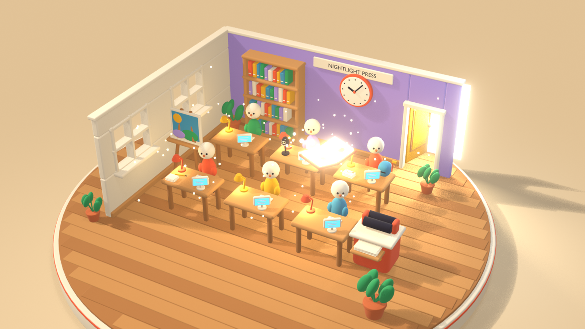
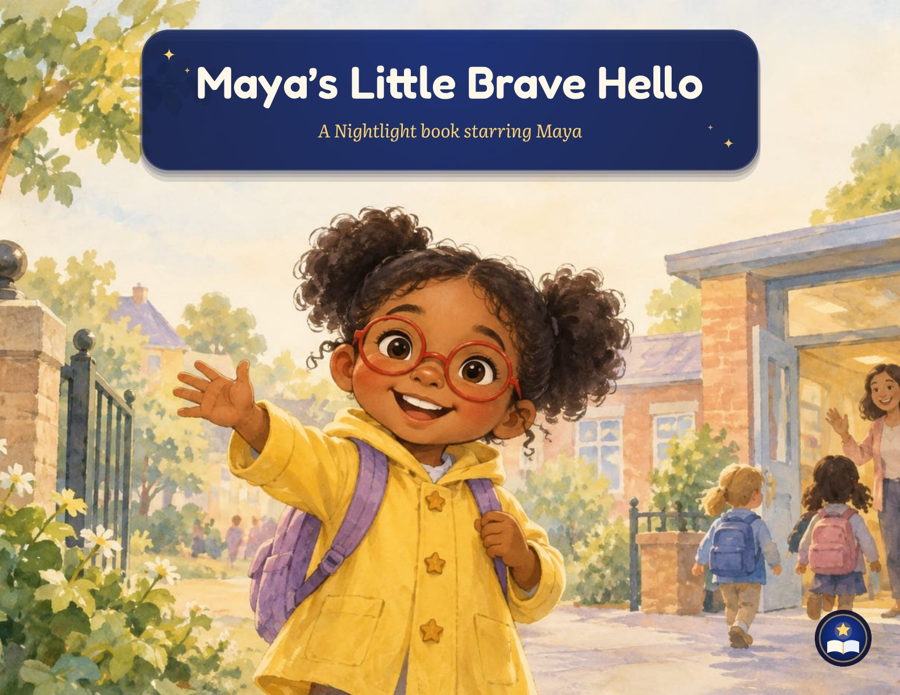
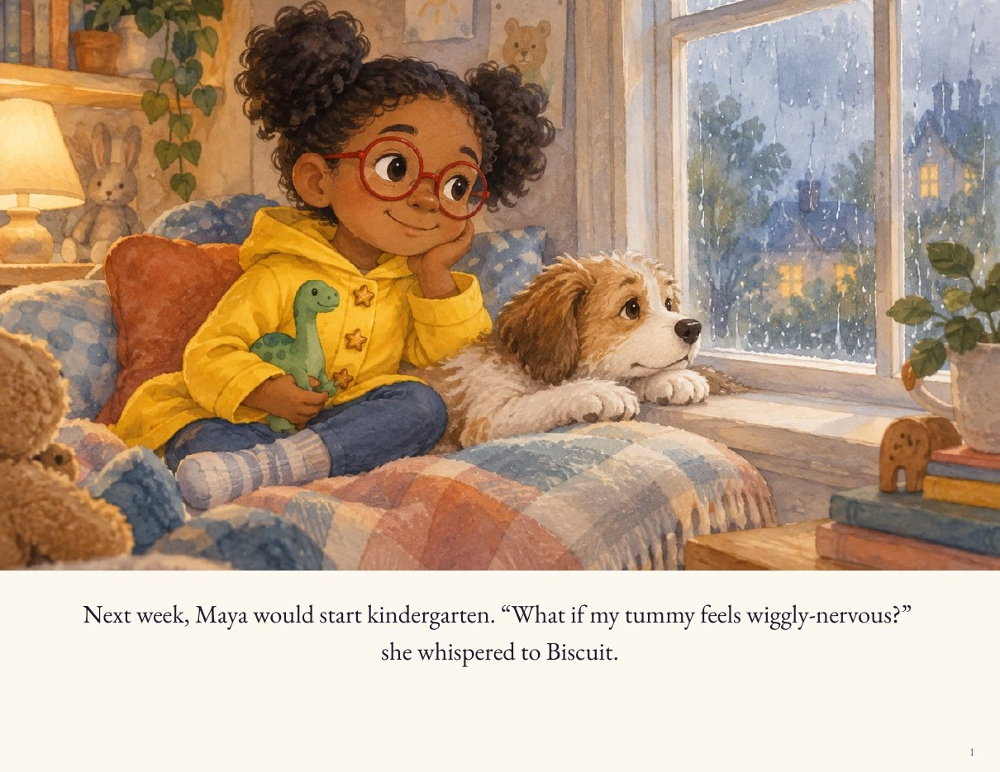
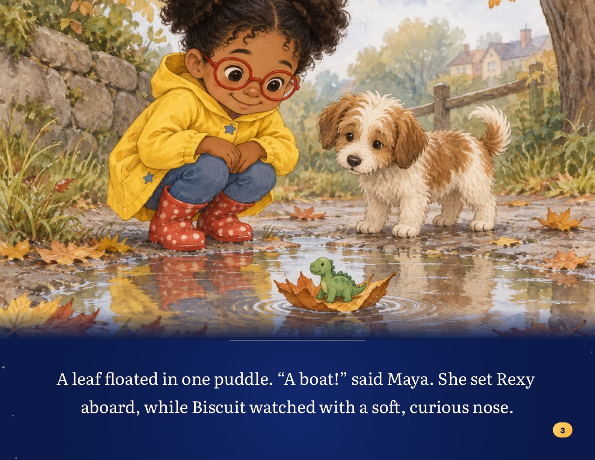
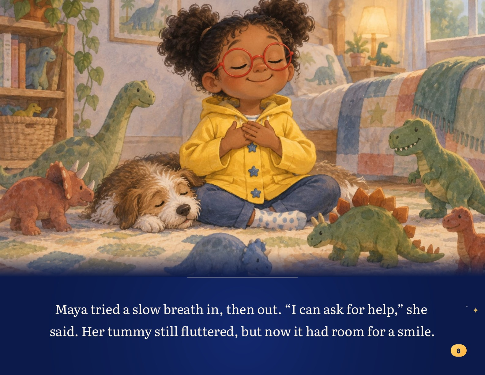
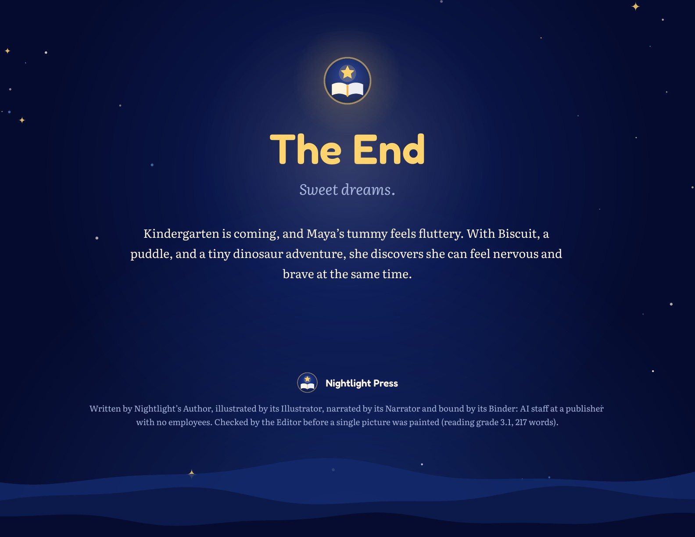

<p align="center">
  <a href="https://nightlight-press-z5ept2z3by3j.vercel.app"></a>
</p>

<h1 align="center">Nightlight Press</h1>

<p align="center"><b>A child says a story out loud. About a minute later, a company with zero employees has written, painted, narrated, bound and emailed a picture book starring them.</b></p>

<p align="center">
  <a href="https://nightlight-press-z5ept2z3by3j.vercel.app"></a>
  <a href="https://nightlight-press-z5ept2z3by3j.vercel.app/tell"></a>
</p>

<p align="center">
  
  <a href="LICENSE"></a>
  
  
  
  
</p>

<p align="center">
  <a href="https://nightlight-press-z5ept2z3by3j.vercel.app"><b>Live demo</b></a> &nbsp;·&nbsp;
  <a href="https://nightlight-press-z5ept2z3by3j.vercel.app/tell"><b>Tell a story</b></a> &nbsp;·&nbsp;
  <a href="https://nightlight-press-z5ept2z3by3j.vercel.app/office"><b>Watch the office</b></a>
</p>

<p align="center"><sub>
  <a href="https://nightlight-press-z5ept2z3by3j.vercel.app/board">Public board</a> ·
  <a href="https://nightlight-press-z5ept2z3by3j.vercel.app/shelf">Free shelf</a> ·
  <a href="https://vnmoorthy.github.io/nightlight-press/">Showcase</a> ·
  <a href="https://vnmoorthy.github.io/nightlight-press/playrobot/">PlayRobot store</a> ·
  <a href="docs/QUICKSTART.md">Quickstart</a> ·
  <a href="docs/ARCHITECTURE.md">Architecture</a> ·
  <a href="docs/HOW_A_BOOK_IS_MADE.md">How a book is made</a> ·
  <a href="https://github.com/vnmoorthy/nightlight-press/releases/tag/v1.0-demo-day">Demo-day deck</a>
</sub></p>

> *"I'm Kai, I'm five, tell me a story from the future where my robot friend and I ride a train to the moon."*
>
> **1.1 minutes later** the book was bound. **1.2** it was in the inbox. **2.0** a real iPhone had proofread it. **2.2** three of its paintings had become films.

---

## ▶ Watch it work

<p align="center">
  <a href="https://nightlight-press-z5ept2z3by3j.vercel.app/office"></a>
  <br><sub>The <a href="https://nightlight-press-z5ept2z3by3j.vercel.app/office">3D office</a> reads the company's public ledger and acts out every step at the desk that did it. Press <b>Replay</b> to watch the last book being made.</sub>
</p>

<table>
  <tr>
    <td width="50%" align="center"><a href="assets/blender/office_flythrough.mp4"></a><br><sub><a href="assets/blender/office_flythrough.mp4"><b>▶ Office fly-through</b></a> (Blender)</sub></td>
    <td width="50%" align="center"><a href="assets/blender/book_open.mp4"></a><br><sub><a href="assets/blender/book_open.mp4"><b>▶ The book opening</b></a> (Blender)</sub></td>
  </tr>
</table>

<p align="center"><sub>Also: <a href="assets/office.mp4">full office screen recording</a> · <a href="assets/film/page-03-animated.mp4">a page the Film desk animated with Kling</a></sub></p>

## Say it, get a book

Every time below was measured on the real line, not estimated.

| | What happens | Who does it | Clock |
|:-:|---|---|---:|
| 🎙️ | A child speaks at [`/tell`](https://nightlight-press-z5ept2z3by3j.vercel.app/tell). A grown-up ticks the permission box. | Browser speech recognition (server transcription as a fallback) | **0:00** |
| ✒️ | The Author turns *their* words into a book set in Fernhush Bay, with Pip the robot friend when that box is ticked. | Naïve agent | |
| 🔎 | The Editor checks every page: word limits for the child's age, the hero's name, banned words and brands, reading grade. A failing draft goes back once, with the exact problems. | Plain code | |
| 🎨 | 8 to 11 paintings and every page's narration are made in parallel. | Monid · Naïve speech | |
| 📕 | The Binder lays out a print-ready PDF. | PDFKit | **1.1 min** |
| 📬 | The Mailroom emails the PDF and the read-aloud link. | AgentMail | **1.2 min** |
| 📱 | The Proofreader opens the book on a real iPhone 16 and reads the title back. | Mobilerun | **2.0 min** |
| 🎬 | The Film desk animates the cover and two key pages into short films. | Kling via Monid | **2.2 min** |
| ✉️ | A parent replies with a change (say, *"her dog is Biscuit, not Cookie"*). A revised book is emailed. | AgentMail webhook → Front Desk | **46 s** |

Kai's book was made live. **Ravi's book was finished with nobody watching**: the queue kept waking itself up until the book was done. A typed order from the shop went from order to inbox in **102 s** (local run, 10 pages).

## Real pages from real books

<p align="center">
  
  
  <br>
  
  
  
  <br>
  
  <br><sub>Every page above came out of the line untouched. The bottom strip is <i>The Moon's Cookie Hill</i>, told out loud by a grown-up and made into a book, with Pip the PlayRobot opted in.</sub>
</p>

<details>
<summary><b>More screens</b>: the shop, the making-of page, the reader, the board, the iPhone proof</summary>
<br>

| Landing | Order form | Making-of, live |
|---|---|---|
|  |  |  |
| **Reader with Read to me** | **Free shelf** | **Public board** |
|  |  |  |

<p align="center">
  &nbsp;&nbsp;
  
  <br><sub>Left: the shop on a phone. Right: Mobilerun's own screenshot from the Proofreader's iPhone 16 run.</sub>
</p>
</details>

## Why this is different

- **An entire company, not a demo.** Shop, payments, writing, editing, painting, narration, binding, delivery, support, revisions, quality checks, marketing and the company's own clock all run as code you can read in this repo.
- **Models write, code decides.** Agents return JSON against a schema. Plain programs decide whether it passes, what happens next, who gets emailed and what it costs. Every rule that matters lives in plain code you can read.
- **A tamper-evident ledger and a public intervention count.** Every consequence is a hash-chained ledger line (`sha256` of the entry plus the previous hash). [`/api/verify`](https://nightlight-press-z5ept2z3by3j.vercel.app/api/verify) re-checks the whole chain. Any time a person steps in, it is logged as an `intervention` and shown on the [public board](https://nightlight-press-z5ept2z3by3j.vercel.app/board).
- **Four clocks and a queue that wakes itself.** A Naïve cron, a `session.idle` webhook, an AgentMail reply webhook and open pages all tick the queue. On top of that, the app calls itself while work is due, so a book finishes even when nobody is watching.
- **Safe for kids by design.** A grown-up permission box before a told story is used; a hold-for-3-seconds grown-up gate when a child taps Pip; the phone storyteller says it is an AI and needs consent; Pip the robot is a checkbox the grown-up can untick, is disclosed in the colophon, and is never allowed to mention buying, shops or prices.

## The staff

Twelve desks. Nobody on payroll.

| Desk | What it does | Agent or code | Runs on |
|---|---|---|---|
| **Author** | Writes one new story per order (16 languages), or adapts a story told out loud. Rewrites when the Editor or a family asks. | Naïve agent | Naïve |
| **Editor** | Word limits by age, the hero's name on the pages, banned words and brands, reading grade, no sales talk when Pip is in. | Code | none |
| **Illustrator** | Paints the cover and every page with one fixed description of the hero (and Pip), so they look the same on every page. The Film desk then animates three of them. | Image model, Kling | Monid |
| **Narrator** | Records every page for **Read to me**. | Speech (OpenAI TTS fallback) | Naïve |
| **Binder** | Lays out the print-ready 11 × 8.5 in landscape PDF. | Code (PDFKit) | none |
| **Mailroom** | Emails the PDF and the reader link; texts US numbers. | Code | AgentMail, Monid |
| **Storyteller Line** | Phones a grandparent and reads the book aloud. Says it is an AI, needs consent, at most 3 calls per book. | Voice line | Monid |
| **Front Desk** | Reads every reply, answers it, routes free revisions to production, escalates refunds and anything worrying to a person. | Naïve agent | Naïve, AgentMail |
| **Proofreader** | Opens each finished book on a real phone and checks the title. | Phone automation | Mobilerun |
| **Marketing** | Commissions a free shelf book every 12 hours and emails subscribers. Social posting is opt-in. | Naïve agent | Naïve |
| **Cashier** | Stripe Checkout at $19. Without a Stripe key it records honest pledges, never counted as revenue. | Code | Stripe (optional) |
| **Night Manager** | Every 5 minutes, calls the app's MCP `tick` tool. It decides nothing. | Scheduled agent | Naïve |

## Architecture

<p align="center"><a href="docs/ARCHITECTURE.md"></a></p>

One Postgres `jobs` table with leases (`for update skip locked`). Each tick works for about 6.5 seconds and anything slow is parked rather than awaited, so the company runs on serverless hosting. A job that needs a model starts an agent session, parks itself, and resumes when the session is done, so a slow model never holds a worker. Full write-up with a Mermaid diagram: **[docs/ARCHITECTURE.md](docs/ARCHITECTURE.md)**. Step by step through one book: **[docs/HOW_A_BOOK_IS_MADE.md](docs/HOW_A_BOOK_IS_MADE.md)**.

## Sponsors, one real job each

| | Concrete job in production |
|---|---|
| **Naïve** | The company's runtime: [`naive.config.ts`](naive.config.ts) declares the agents, their budgets, the 5-minute Night Manager schedule, the hosted app with Postgres and its MCP endpoint, the vault, and the `session.idle` webhooks. Naïve speech voices the pages. |
| **Monid** | Paints every picture, turns three of them into Kling films, sends the delivery SMS, and runs the Storyteller Line phone number. |
| **AgentMail** | Delivers every book with the PDF attached, and is the front door: a reply fires `message.received`, the Front Desk reads it, and a revised book goes out. |
| **Mobilerun** | Gives the Proofreader a real iPhone 16: it opens the live book in Safari and reads the title back. |

## Unit economics

| Per book | Cost |
|---|---:|
| Paintings (≈ $0.011 each, 8 to 11 per book) | $0.09 to $0.12 |
| Kling films (3 × $0.21) | $0.63 |
| Agent runs | < $0.01 |
| Stripe fee on $19 | $0.85 |
| **Total** | **≈ $1.60** |
| **Gross margin at $19** | **≈ 90%** |

No inventory and no backlog: a book costs almost nothing until someone asks for it, and it is ready in about two minutes.

## Run it yourself

**You need:** Node.js 20+, Docker (for Postgres), and API keys for Naïve, Monid, AgentMail and Mobilerun, plus OpenAI for the speech fallback. Stripe is optional; without it the shop runs in pledge mode.

```bash
git clone https://github.com/vnmoorthy/nightlight-press
cd nightlight-press
cp .env.example .env                       # fill in your keys (never commit this file)
cp app/.env.example app/.env.local         # DATABASE_URL and local settings
docker run -d --name nightlight-db -p 5432:5432 \
  -e POSTGRES_PASSWORD=postgres -e POSTGRES_DB=nightlight postgres:16
cd app && npm i && ./dev.sh                # http://localhost:3100, migrations apply on boot
```

Then open `/` to order, `/tell` to tell a story, `/order/<id>` to watch the book being made, and `/office` and `/board` to watch the company work. The full walkthrough, including what each key unlocks, is in **[docs/QUICKSTART.md](docs/QUICKSTART.md)**.

<details>
<summary><b>Environment variables</b></summary>
<br>

Every variable is listed, with a comment, in [`.env.example`](.env.example) (company keys and wiring) and [`app/.env.example`](app/.env.example) (local database and tuning). Names only:

- **Keys:** `NAIVE_API_KEY`, `MONID_API_KEY`, `AGENTMAIL_API_KEY`, `MOBILERUN_API_KEY`, `OPENAI_API_KEY`, `STRIPE_SECRET_KEY` (optional)
- **Wiring:** `DATABASE_URL`, `PUBLIC_BASE_URL`, `MONID_NUMBER_ID`, `MONID_FROM_E164`, `MONID_VOICE_PROVIDER`, `AGENTMAIL_INBOX_ID`, `NAIVE_AGENT_AUTHOR`, `NAIVE_AGENT_FRONTDESK`, `NAIVE_AGENT_MARKETER`, `MOBILERUN_DEVICE_ID`
- **Security:** `ADMIN_TOKEN`, `AGENTMAIL_WEBHOOK_SECRET`, `NAIVE_WEBHOOK_SECRET`
- **Behaviour:** `WORLD`, `FILM`, `TOLD_PAGES`, `BOOK_PAGES`, `SHELF_EVERY_HOURS`, `AUTO_SHELF`, `MOBILERUN_SOCIAL`, `PLAYROBOT_TOY_URL`
</details>

## Deploy your own company on Naïve

```bash
npm install          # the Naïve SDK and CLI, at the repo root
./deploy.sh          # builds the app, then reconciles identity, vault, agents, schedules and the hosted app
```

`deploy.sh` reads the same `.env`, bundles the app with esbuild, and runs `naive up` against [`naive.config.ts`](naive.config.ts), retrying if Naïve is busy. On a fresh account, run `NL_WITH_APPS=0 ./deploy.sh` first to create the agents, put their ids into `NAIVE_AGENT_AUTHOR`, `NAIVE_AGENT_FRONTDESK` and `NAIVE_AGENT_MARKETER`, then run `./deploy.sh` to bring up the hosted app.

## Make it yours

Nightlight is a template for any company that makes something personal on demand.

- **Swap the world.** Every book is set in Fernhush Bay, a seaside town designed by GPT-6 Astra where robots, people with bionic parts and kids live side by side. The world bible is [`prompts/world.md`](prompts/world.md), with art direction in [`prompts/world_art.md`](prompts/world_art.md), story seeds in [`prompts/world_seeds.md`](prompts/world_seeds.md), and Astra's original in [`prompts/world/astra-world.json`](prompts/world/astra-world.json). Set `WORLD=classic` to turn it off.
- **Rewrite the staff.** Each agent's job is a plain Markdown prompt: [`author.md`](prompts/author.md), [`teller.md`](prompts/teller.md), [`frontdesk.md`](prompts/frontdesk.md), [`marketer.md`](prompts/marketer.md). They are compiled into the app by `app/gen-prompts.mjs`.
- **Change the robot.** Pip's look and role are two strings, `ROBOT_LOOK` and `ROBOT_STORY`, in `app/src/prompts.js`.
- **Change the price.** `PRICE_CENTS` (default `1900`). Book length is `BOOK_PAGES` and `TOLD_PAGES`.
- **Add a desk.** A desk is one job handler in `app/src/engine.js`. See [CONTRIBUTING.md](CONTRIBUTING.md#add-a-desk).

## FAQ

<details>
<summary><b>Is it safe for kids?</b></summary>
<br>

That is the first design constraint, and most of it is enforced in code rather than in prompts. The Editor is a program: it rejects pages over the age's word limit, unsuitable words, trademarked characters and web addresses before anything is painted. A grown-up must tick a permission box before a told story is used. Pip is a checkbox the grown-up can untick, Pip is credited in the book's colophon, and any page where Pip's book mentions buying, shops or prices is rejected. Tapping Pip in the reader opens a hold-for-3-seconds grown-up gate before the toy page. The phone storyteller says it is an AI, needs consent and makes at most 3 calls per book. Agents are deny-by-default with budget caps: the creative agents only return JSON, and the Night Manager may call only a few read-and-tick MCP tools.
</details>

<details>
<summary><b>Who can see a book?</b></summary>
<br>

A book ordered from the shop is unlisted: it is not on the shelf and is opened by its link. A story told at `/tell` goes on the public shelf only if the grown-up ticks *Share*. Marketing's own nightly books are public. If you run your own instance, those books live in your own Postgres database. The code is MIT-licensed.
</details>

<details>
<summary><b>What does a book cost?</b></summary>
<br>

$19, one-time, for a painted cover and pages, a print-ready PDF, a read-aloud web book and free revisions by email. It costs about $1.60 to make, including the Stripe fee and three Kling films. Without a Stripe key the hosted instance records pledges instead of taking money.
</details>

<details>
<summary><b>Can I change the robot?</b></summary>
<br>

Yes. Pip is two strings in `app/src/prompts.js` (`ROBOT_LOOK` for how Pip is drawn on every page, `ROBOT_STORY` for Pip's role in the story), and the grown-up toy link is `PLAYROBOT_TOY_URL`. Pip is a checkbox, so any book can leave Pip out.
</details>

<details>
<summary><b>Do I need every sponsor key?</b></summary>
<br>

Each desk needs its own: Naïve for the Author, Front Desk, Marketing and narration; Monid for paintings, films, SMS and calls; AgentMail for delivery and replies; Mobilerun for the iPhone proof. Proofs are skipped (and logged) when no phone is connected or the book is on `localhost`, films and self-continuation are off unless `PUBLIC_BASE_URL` is `https://`, and the Cashier runs in pledge mode without Stripe. Without Naïve or Monid no book can be made.
</details>

## Roadmap

- [ ] One-command local run with a seeded demo book (no keys needed to look around)
- [ ] Tests for the Editor and the queue in CI
- [ ] Printed hardcovers through a print-on-demand partner
- [ ] Reading-level checks for languages other than English
- [ ] A second world bible to show the template off
- [ ] Per-family library page for every book a child has starred in

Good first issues are drafted in [docs/STARTER_ISSUES.json](docs/STARTER_ISSUES.json).

## Contributing

Pull requests are welcome. Start with [CONTRIBUTING.md](CONTRIBUTING.md): local setup, how the queue works, and how to add a desk. Please read the [Code of Conduct](CODE_OF_CONDUCT.md), and report security issues privately as described in [SECURITY.md](SECURITY.md). Changes are recorded in [CHANGELOG.md](CHANGELOG.md).

<details>
<summary><b>Repo layout</b></summary>
<br>

```
nightlight-press/
├── naive.config.ts        # the company blueprint: identity, vault, agents, schedules, hosted app
├── deploy.sh              # build + `naive up`, with retry when Naïve is busy
├── prompts/               # author, teller, frontdesk, marketer, and the Fernhush Bay world bible
├── app/
│   ├── dev.sh             # local server on :3100
│   ├── gen-prompts.mjs    # compiles prompts/, migrations and fonts into the app
│   ├── build.mjs          # esbuild bundle for serverless hosting
│   ├── migrations/        # orders, books, pages, jobs, ledger, ...
│   ├── src/
│   │   ├── app.js         # routes: shop, tell, reader, board, office, webhooks, /mcp
│   │   ├── engine.js      # every desk's job handler, tick(), self-continuation
│   │   ├── jobs.js        # Postgres job queue with leases
│   │   ├── db.js          # Postgres, migrations, hash-chained ledger
│   │   ├── editor.js      # the Editor's checks
│   │   ├── picturebook.js # the Binder: PDFKit layout
│   │   ├── naive.js · monid.js · agentmail.js · mobilerun.js · stripe.js
│   │   ├── mcp.js         # MCP tools: tick, board_summary, commission_shelf_book, ...
│   │   └── views/         # server-rendered pages
│   └── public/js/         # office.js (Three.js), reader, order, tell, pip, ...
├── assets/                # hero, screenshots, diagram, Blender films, iPhone proofs
└── docs/                  # architecture, quickstart, how a book is made
```
</details>

<details>
<summary><b>Credits</b></summary>
<br>

- Fernhush Bay and the cinematic renders in [`assets/blender/`](assets/blender/) were designed and scripted by OpenAI GPT-6 Astra; the films were rendered in Blender 5.2 EEVEE.
- Built with Naïve, [Monid](https://monid.ai), [AgentMail](https://agentmail.to) and [Mobilerun](https://mobilerun.ai), plus [Hono](https://hono.dev), [Three.js](https://threejs.org), [PDFKit](https://pdfkit.org), [sharp](https://sharp.pixelplumbing.com) and Stripe.
- Type: Fredoka, Nunito, Literata and EB Garamond (SIL Open Font License).
</details>

## License

[MIT](LICENSE). If Nightlight Press made you smile, a ⭐ helps other people find it.

<p align="center"><sub>Built at the Naïve × YC Autonomous Company Hackathon by <a href="https://github.com/vnmoorthy">vnmoorthy</a>.</sub></p>
