<p align="center">
  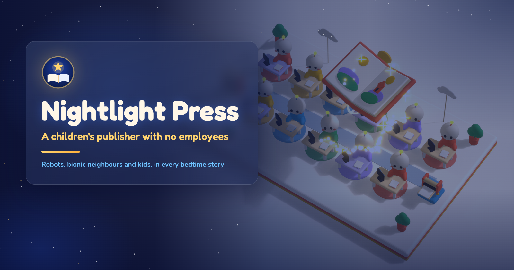
</p>

<h1 align="center">Nightlight Press</h1>

<p align="center"><b>A bedtime picture book starring your child, written, painted, narrated, bound and emailed in under two minutes by a publisher with no employees.</b></p>

<p align="center">
  <a href="https://nightlight-press-z5ept2z3by3j.vercel.app"></a>
</p>

<p align="center">
  
  
  
  
  <br>
  
  
  
  
  
</p>

<p align="center">
  <a href="https://nightlight-press-z5ept2z3by3j.vercel.app">Shop</a> ·
  <a href="https://nightlight-press-z5ept2z3by3j.vercel.app/office">3D office</a> ·
  <a href="https://nightlight-press-z5ept2z3by3j.vercel.app/board">Public board</a> ·
  <a href="https://nightlight-press-z5ept2z3by3j.vercel.app/shelf">Free shelf</a> ·
  <a href="https://nightlight-press-z5ept2z3by3j.vercel.app/tell">Tell a story</a> · <a href="https://vnmoorthy.github.io/nightlight-press/">Showcase</a> · <a href="https://vnmoorthy.github.io/nightlight-press/playrobot/">PlayRobot store</a> · <a href="docs/ARCHITECTURE.md">Architecture</a>
</p>

---

Tell Nightlight Press your child's name, what they look like and what they love. Twelve desks of AI agents and plain programs write a brand-new story in your child's language, paint ten pages and a cover, record a read-aloud, bind a print-ready PDF and email it to you. Reply to the email with a change ("her dog is Biscuit, not Cookie") and a revised book comes back in under a minute.

Built for the Naïve × YC **Autonomous Company Hackathon**. The question the judges ask is how much of the company runs without you. Our answer: the shop, production, delivery, support, revisions, quality checks, marketing and the company's own clock. A person only appears when something needs one, and every time that happens it is logged in public on the board.

**What you get for $19 (one-time):** 10 painted pages plus a painted cover · a print-ready 11 × 8.5 in landscape PDF · a read-aloud web book with **Read to me** · free revisions by replying to the email or using the box beside the book.

<p align="center">
  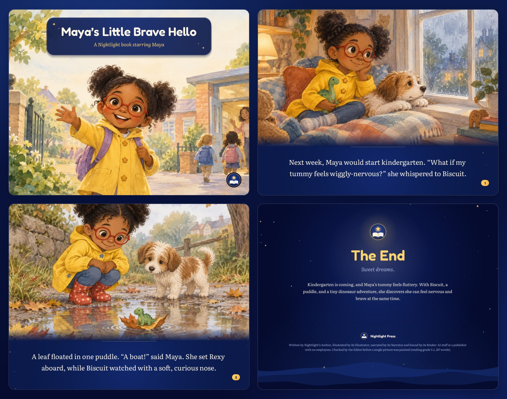
  <br><sub>Pages from <i>Maya's Little Brave Hello</i>, a real book made by the line.</sub>
</p>

## Watch the office

<p align="center">
  <a href="https://nightlight-press-z5ept2z3by3j.vercel.app/office">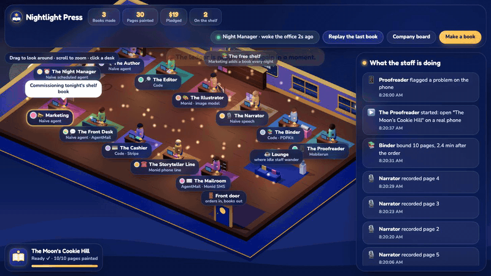</a>
</p>

[`/office`](https://nightlight-press-z5ept2z3by3j.vercel.app/office) is a Three.js floor with all 12 desks. It reads the company's public ledger and acts out each step at the desk that did it. Press **Replay** to watch the last book being made from start to finish. Longer cuts: [office screen recording](assets/office.mp4) · [cinematic office fly-through](assets/blender/office_flythrough.mp4) · [the book opening](assets/blender/book_open.mp4).

## Order to inbox in 102 seconds

These timings were measured on a local run of the same code that is deployed.

1. **Order.** A parent fills in the form at `/`: name, age, look, favorite things, language (16 to choose from), art style. The **Cashier** takes $19 through Stripe Checkout (on the hosted instance, until a Stripe key is added, it records an honest pledge instead).
2. **Commission.** Code opens a book, writes a `commission` line to the ledger and enqueues one `write` job.
3. **Write.** The **Author**, a Naïve agent, returns the story as JSON. The **Editor**, a program, checks it: word limits for the child's age, the child's name on the pages, no banned words or brands, the right reading grade. If the draft fails, the Editor sends it back once with the exact problems.
4. **Paint and narrate, in parallel.** The queue fans out 11 `paint` jobs (cover plus 10 pages) to the **Illustrator** on Monid and 10 `narrate` jobs to the **Narrator** on Naïve speech.
5. **Bind.** When every page has a picture and a voice, the **Binder** (PDFKit) lays out the print-ready PDF. **Book bound at 1.6 minutes.**
6. **Deliver.** The **Mailroom** emails the PDF and the reader link through AgentMail, plus an SMS through Monid for US numbers. **In the inbox at 102 seconds.**
7. **Proof and phone.** The **Proofreader** opens the finished book on a real phone through Mobilerun. If the family asked, the **Storyteller Line** phones Grandma and reads the book aloud.
8. **Revise.** The family replies to the email. AgentMail's webhook wakes the **Front Desk**, which routes the change to `revise`. **Revised book re-emailed in 46 seconds.**

| Landing | Order form | Making-of, live |
|---|---|---|
| 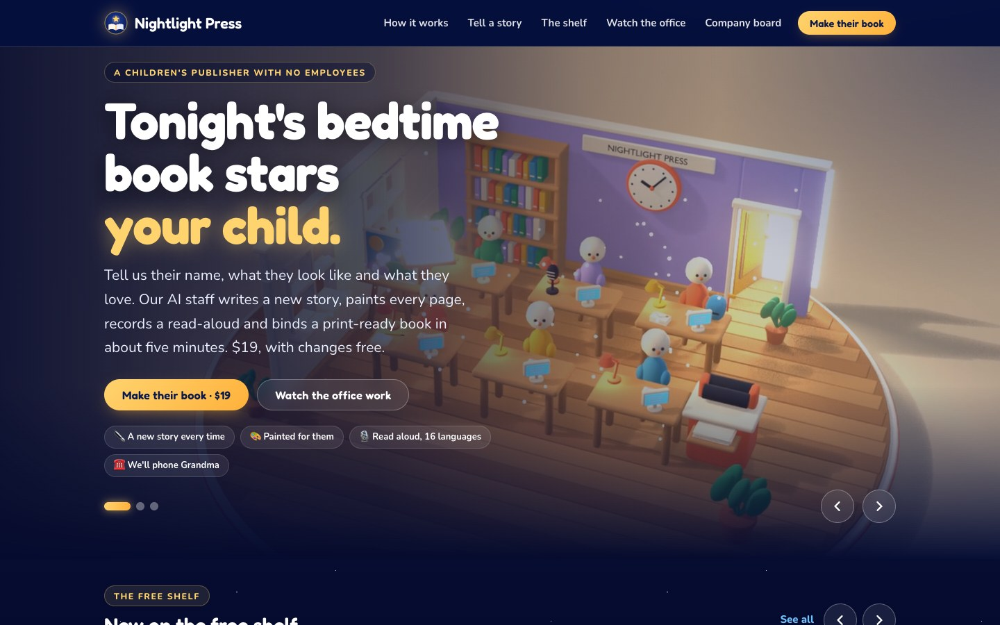 | 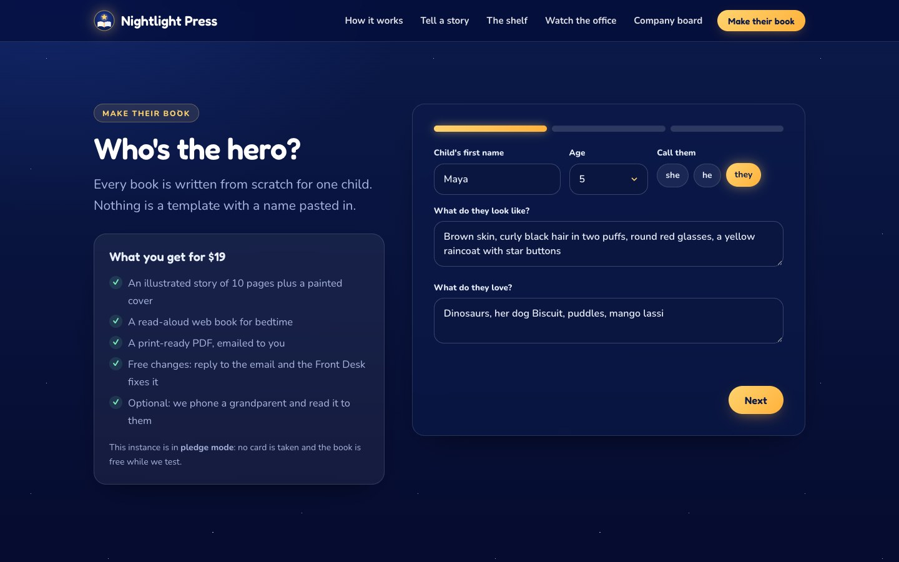 | 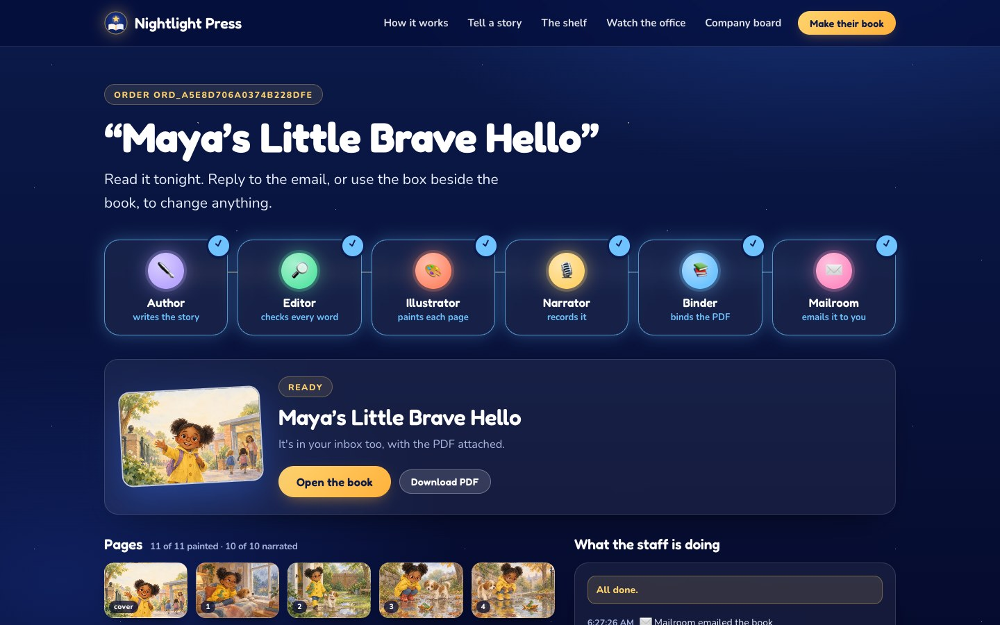 |
| **Reader with Read to me** | **Free shelf** | **Public board** |
| 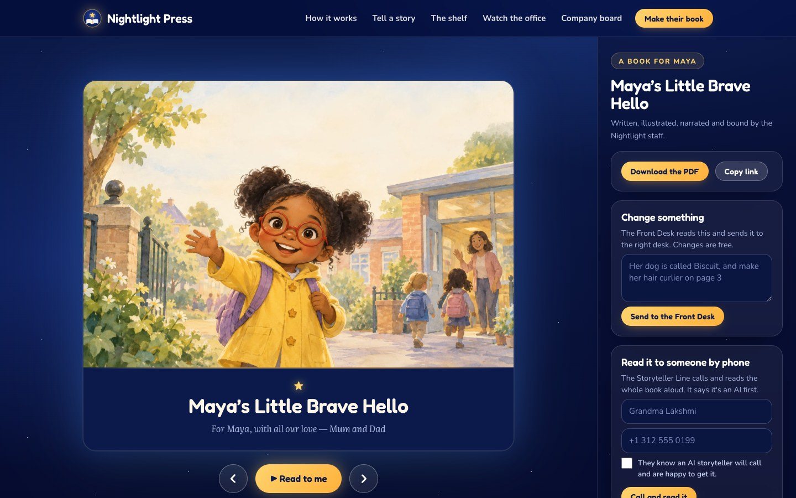 | 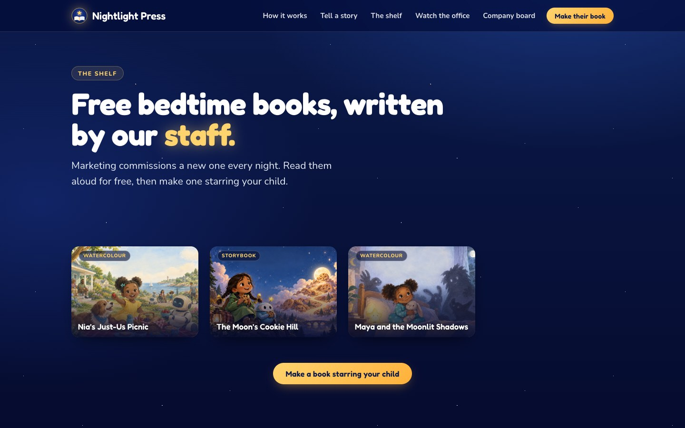 | 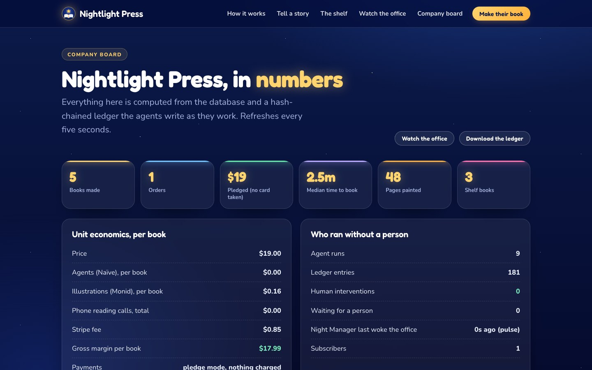 |

<p align="center">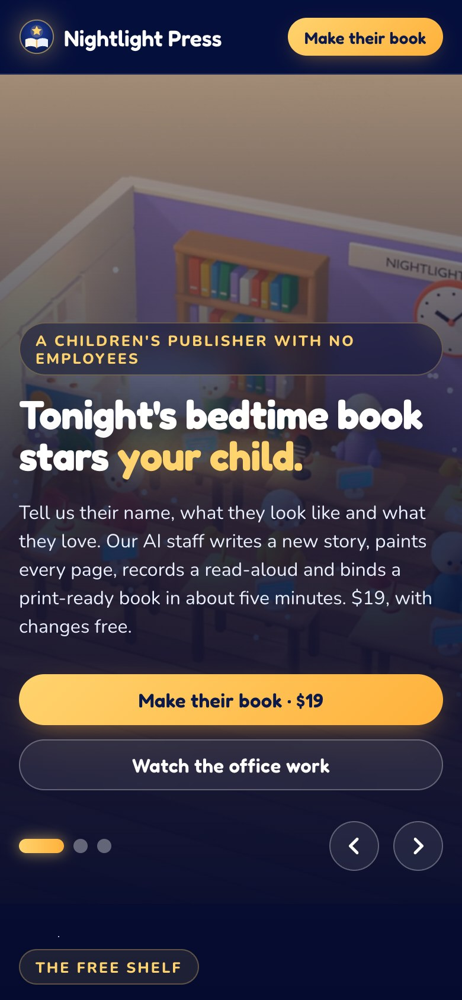&nbsp;&nbsp;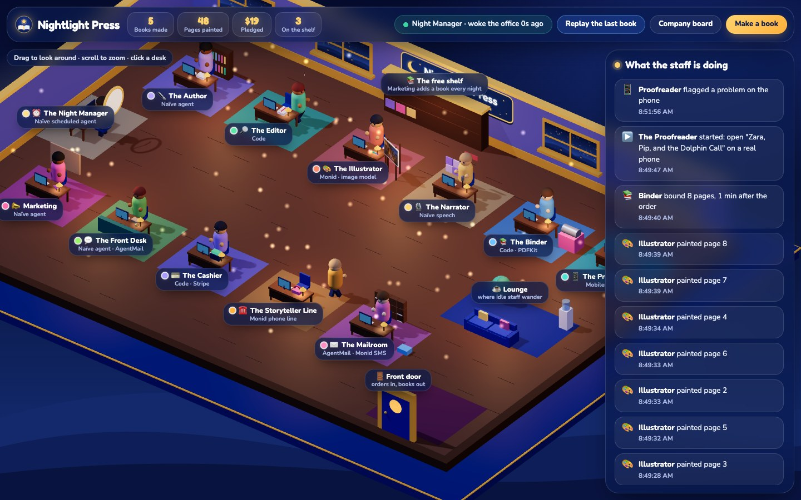</p>

## Tell a story out loud, get a book

Open [`/tell`](https://nightlight-press-z5ept2z3by3j.vercel.app/tell), press the microphone and tell any story: a bedtime tale, something that happened today, a story from when you were small. Your words appear on screen as you speak (browser speech recognition, or a recording transcribed on the server). Press **Make it a book** and the same line goes to work: the Author adapts *your* plot, characters and phrases rather than inventing a new story, the Editor checks it, the Illustrator paints it and the Narrator reads it. Told books go on the free shelf.

Measured locally: a 120-word spoken story about a girl who rescues the moon became *The Moon's Cookie Hill*. Every plot beat was kept in order, including the teller's own line "like a big round cookie". The manuscript took about 30 seconds and all ten paintings about a minute.

<p align="center">
  
  <br><sub>Pages 3, 6 and 9 of <i>The Moon's Cookie Hill</i>, told out loud and made by the line, with Pip the robot friend opted in.</sub>
</p>

**Pip the PlayRobot, opt-in and disclosed.** Families (or a teller) can tick *Add Pip the PlayRobot as a friend*. Pip is a kind robot sidekick, drawn identically on every page from one fixed description. The book's colophon credits the character, and the Editor rejects any page that mentions buying, shops or prices. A recurring, disclosed character is how a toy brand can live in children's stories without advertising to children.

## The staff

There are 12 desks and no employees. Models write, paint and talk. Code decides when, whether and how much.

| Desk | What it does | Agent or code | Sponsor |
|---|---|---|---|
| **Author** | Writes one new story per order, in the child's language (16 languages) and at their reading level. Rewrites when the Editor or a family asks. | Naïve agent | Naïve |
| **Editor** | Checks word limits by age, the child's name on the pages, banned words and brands, and reading grade. Sends a draft back once. | Code | none |
| **Illustrator** | Paints the cover and all 10 pages with the image model `gpt-image-2.5-sunburst`. | Image model | Monid |
| **Narrator** | Records every page for **Read to me**. Naïve speech first, with OpenAI TTS as a fallback. Locally, 19 of 25 page narrations came from Naïve speech. | Speech | Naïve |
| **Binder** | Lays out the print-ready 11 × 8.5 in landscape PDF. | Code (PDFKit) | none |
| **Mailroom** | Emails the PDF and the reader link. Sends an SMS to US numbers. | Code | AgentMail + Monid |
| **Storyteller Line** | Phones a grandparent and reads the book aloud. It says it is an AI, needs consent, and makes at most 3 calls per book. | Voice line | Monid |
| **Front Desk** | Reads every reply from families, by email or from the box beside the book. Answers them, routes free revisions to production, and escalates refunds or anything worrying to a person. | Naïve agent | Naïve + AgentMail (inbound webhook) |
| **Proofreader** | Opens each finished book on a real phone. | Phone automation | Mobilerun |
| **Marketing** | Commissions a free shelf book every 12 hours, writes its caption and emails subscribers. Posting to Instagram through Mobilerun is opt-in. | Naïve agent | Naïve |
| **Cashier** | Runs Stripe Checkout at $19, one-time. Until the founder adds a key, the hosted instance runs in honest **pledge mode**: orders are recorded as pledges and never counted as revenue. | Code | none (Stripe) |
| **Night Manager** | Every 5 minutes, calls the app's MCP `tick` tool and reads back a board summary. It decides nothing. | Naïve scheduled agent | Naïve |

## Architecture

<p align="center">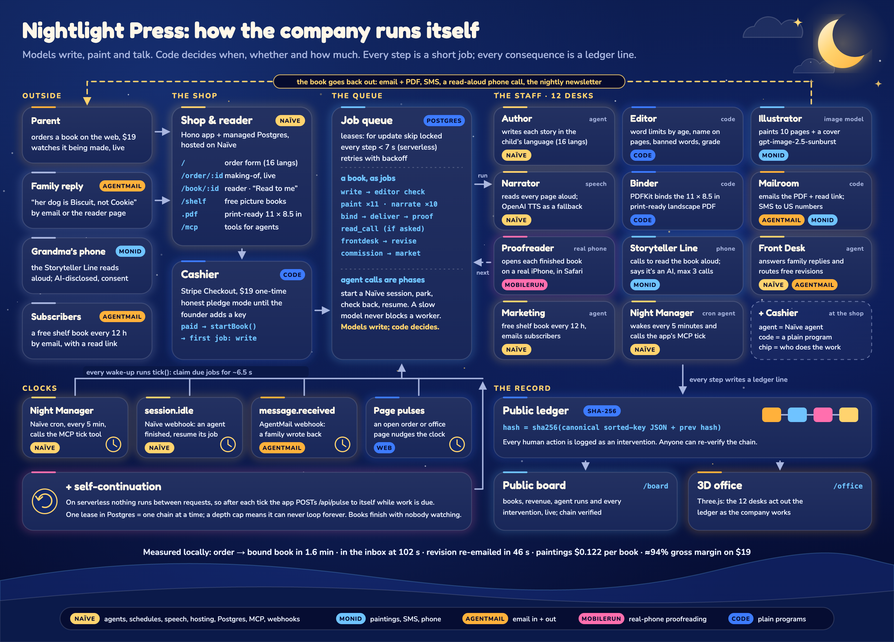</p>

The full write-up, with a Mermaid diagram, is in **[docs/ARCHITECTURE.md](docs/ARCHITECTURE.md)**. The short version:

- **One job queue.** Every step is a row in a Postgres `jobs` table. Workers claim jobs with leases (`for update skip locked`). Every step finishes in under 7 seconds, so the company runs on serverless hosting.
- **Agents are phases, not threads.** A job that needs a model starts a Naïve agent session, parks itself, comes back to check, and resumes when the session is done. A slow model never holds a worker.
- **Models write, code decides.** Agents return JSON against a schema. Programs decide whether it passes, what happens next, what gets sent and what it costs.
- **A public, hash-chained ledger.** Every consequence is a ledger line: `hash = sha256(canonical sorted-key JSON + prev_hash)`. The board shows it and anyone can re-verify the chain. The 3D office replays it.

## How it runs without people

Nothing in this company waits for a person. Five things wake it up:

| Clock | What wakes it | What it does |
|---|---|---|
| **Night Manager cron** | A Naïve schedule, every 5 minutes | Calls the app's MCP `tick` tool, which claims due jobs for about 6.5 s. Verified ticking on the hosted app. |
| **`session.idle` webhook** | Naïve, when an agent session finishes | Resumes the parked job right away instead of waiting for the next poll. |
| **`message.received` webhook** | AgentMail, when a family replies | Enqueues a Front Desk job and ticks. |
| **Page pulses** | Any open making-of, reader, board or office page | Nudges the clock while someone is watching. |
| **Self-continuation** | The app itself | After each tick, while work is due, the app calls its own `/api/pulse`. A single lease in Postgres keeps it to one chain at a time, and a depth cap stops it from looping forever. A book finishes even if nobody is watching and no cron is due. |

On top of the clocks:

- **Marketing commissions a free book every 12 hours.** The claim is atomic, so two ticks at the same moment can never commission the same night's book twice. Marketing then publishes the book to `/shelf` and emails subscribers.
- **Families fix their own books.** Revisions are free. The Front Desk reads the reply and production redoes only the pages that changed.
- **Failures retry.** A job that errors backs off and retries, up to 4 attempts. If it still fails, that is logged on the ledger as `job_failed`, so it is public.
- **Humans are logged.** Any action a person takes, such as retrying a failed job or commissioning a book by hand, is written to the ledger as an `intervention` and shown on the public board. The less often that list grows, the more autonomous the company is.

## Sponsors

Each sponsor has one concrete job in production.

### Naïve: the company's runtime
`naive.config.ts` is the company blueprint. It defines the four agents (Author, Front Desk, Marketing, Night Manager) and their budgets, the Night Manager's 5-minute schedule, the hosted fullstack app (Hono) with managed Postgres and its MCP endpoint, the vault and identity that hold the sponsor credentials, and the `session.idle` webhooks. Naïve speech also voices every page. **Concrete job:** a scheduled Naïve agent wakes the office every 5 minutes by calling `nightlight-press.tick`. Agent runs cost under $0.01 per book.

### Monid: paintings, texts and phone calls
**Concrete job:** Monid paints all 11 pictures in every book with `gpt-image-2.5-sunburst`, about $0.011 each and $0.122 per book. Monid also sends the delivery SMS to US numbers and runs the Storyteller Line, which phones a grandparent and reads the book aloud. The line says it is an AI, needs consent, and makes at most 3 calls per book.

### AgentMail: the mailroom and the front door
**Concrete job:** AgentMail delivers every book as an email with the PDF attached, and the measured local run had it in the inbox at 102 s. It is also how families talk back. A reply fires AgentMail's `message.received` webhook, the Front Desk reads it, and a revised book goes out in 46 s. Marketing's nightly newsletter goes out through AgentMail too.

### Mobilerun: a proofreader with a real phone
**Concrete job:** the Proofreader opens each finished book on a real phone, the same way a parent would. We tested it on the founder's iPhone 16. Mobilerun opened the live site in Safari and read the headline back exactly, in 3 steps. Marketing can also post to Instagram from the phone, but only if that is switched on (opt-in).

<p align="center">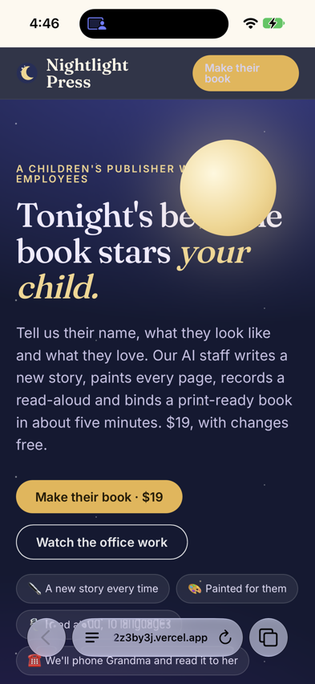<br><sub>Mobilerun's own screenshot from the iPhone run. More in <a href="assets/mobilerun/">assets/mobilerun/</a>.</sub></p>

## Unit economics

Per $19 book, measured locally:

| | Per book |
|---|---|
| Price | **$19.00** one-time |
| Stripe fee | $0.85 |
| Paintings (11 × ~$0.011, Monid) | $0.122 |
| Agent runs (Naïve) | < $0.01 |
| **Gross margin** | **≈ 94%** |

The costs listed above add up to less than $1. We quote about 94% to leave room for speech, email and hosting. Speed matters here as well: a book costs almost nothing until it is ordered, and one is ready in under two minutes, so there is no inventory and no backlog. The free shelf book that Marketing publishes every 12 hours goes through the same line, so it costs about as much to make as a customer's book.

## Trust & safety

- **The Editor is code, not a model.** Word limits by age, the child's name on the pages, banned words and brands, and reading grade are all checked by a program before anything gets painted.
- **The Storyteller Line says it is an AI.** It needs consent and makes at most 3 calls per book. SMS goes only to US numbers.
- **Agents cannot touch the app.** Every agent is deny-by-default: no app access and no tools, except the Night Manager, which may call only `tick` and `board_summary`. Each agent has a budget cap.
- **Public posting is opt-in.** Posting to Instagram from a phone is public and permanent, so it stays off unless it is switched on explicitly.
- **Escalation.** The Front Desk does not promise anything the code has not done. It passes refunds and anything worrying to a person, and that person's action is logged as an intervention.
- **Honest money.** Until a Stripe key is added, the hosted instance runs in pledge mode, and pledges are never reported as revenue.
- **Tamper-evident record.** The ledger is hash-chained, and `/api/verify` re-checks the whole chain.
- **Secrets stay out of the repo.** Sponsor keys live in the Naïve vault and in local `.env` files, which are in `.gitignore`. Inbound webhooks are signature-checked: Svix signatures for AgentMail and HMAC signatures for Naïve.

## What we learned

- **Don't give agents the keys to the building.** We first set up the blueprint with Naïve board tasks. Given those tasks, an agent pulled the app, edited it by hand and redeployed it. We fixed it by removing the tasks and giving agents no app access. Now every piece of production is a job in the app's queue. The creative agents only return JSON, and the Night Manager can only call `tick` and `board_summary`.
- **The clock has to be boring.** A batch model rejected the Night Manager's cron runs, so the company stopped ticking. We moved the Night Manager to a small, fast model whose whole job is to call one tool.
- **Serverless means nobody is home between requests.** That is why there are four clocks plus self-continuation, and why every step is a job that takes under 7 seconds. A long agent call becomes a phase that is started, parked, checked and resumed.
- **Models write, code decides.** Any rule that matters (word counts, names, reading level, who gets texted, how many calls) lives in code where it can be tested. The models do the creative work.
- **Fallbacks are a feature.** Locally, 19 of 25 page narrations came from Naïve speech and the other 6 came from the OpenAI TTS fallback, so no book waited on its voice.

## Run it yourself

**Prerequisites:** Node.js 20 or newer, a Postgres database, and accounts with Naïve, Monid, AgentMail and Mobilerun, plus an OpenAI key for the TTS fallback. Stripe is optional. Without it, the shop runs in pledge mode.

```bash
git clone https://github.com/vnmoorthy/nightlight-press
cd nightlight-press
npm install                 # Naïve SDK + CLI (blueprint, deploy)
(cd app && npm install)     # the app: Hono, pg, PDFKit, sharp, Stripe, Three.js
```

Put your keys in a `.env` file at the repo root. It is in `.gitignore`, so never commit it.

```bash
NAIVE_API_KEY=
MONID_API_KEY=
AGENTMAIL_API_KEY=
MOBILERUN_API_KEY=
OPENAI_API_KEY=
# optional: without it the Cashier runs in pledge mode
STRIPE_SECRET_KEY=
```

Create `app/.env.local` with your `DATABASE_URL`. The optional wiring, such as the AgentMail inbox, the Monid number and the agent ids, is listed under `env` in `naive.config.ts`.

```bash
app/dev.sh      # runs the app on http://localhost:3100; migrations apply on boot
./deploy.sh     # builds the app and reconciles identity, vault, agents, schedules and the hosted app on Naïve
```

Open `/` to order, `/order/<id>` to watch the book being made, `/office` and `/board` to watch the company work.

## Repo layout

```
nightlight/
├── naive.config.ts        # the company blueprint: identity, vault, agents, schedules, hosted app
├── deploy.sh              # build + `naive up`, with retry when Naïve is busy
├── prompts/               # author.md, frontdesk.md, marketer.md (compiled into the app)
├── app/
│   ├── dev.sh             # local server on :3100
│   ├── build.mjs          # esbuild bundle for serverless hosting
│   ├── migrations/        # 001_init.sql: orders, books, pages, jobs, ledger, ...
│   ├── src/
│   │   ├── app.js         # Hono routes: shop, reader, board, office, webhooks, /mcp
│   │   ├── engine.js      # the operating procedure: every desk's job handler, tick(), self-continuation
│   │   ├── jobs.js        # Postgres job queue with leases
│   │   ├── db.js          # Postgres, migrations, hash-chained ledger
│   │   ├── naive.js       # Naïve agent sessions + speech
│   │   ├── monid.js       # paintings, SMS, the Storyteller Line
│   │   ├── agentmail.js   # outbound mail
│   │   ├── mobilerun.js   # real-phone tasks
│   │   ├── stripe.js      # Checkout (or pledge mode)
│   │   ├── editor.js      # the Editor: word limits, names, banned words, reading grade
│   │   ├── picturebook.js # the Binder: PDFKit layout
│   │   ├── mcp.js         # MCP tools: tick, board_summary, commission_shelf_book, recent_books, note
│   │   ├── media.js       # media storage
│   │   └── views/         # server-rendered pages
│   └── public/            # CSS, client JS, the Three.js office (js/office.js)
├── assets/                # hero, screenshots, architecture diagram, Blender renders, Mobilerun proofs
└── docs/ARCHITECTURE.md   # how the engine works
```

## Credits

- The **cinematic renders** in [`assets/blender/`](assets/blender/) were scripted by **OpenAI GPT-6 Astra** and rendered in **Blender 5.2 EEVEE**: the hero still, the [office fly-through](assets/blender/office_flythrough.mp4) and the [book opening](assets/blender/book_open.mp4). Astra's scripts, briefs and review rounds are kept next to them in `scripts/` and `notes/`.
- Built with Naïve, [Monid](https://monid.ai), [AgentMail](https://agentmail.to) and [Mobilerun](https://mobilerun.ai), with [Hono](https://hono.dev), [Three.js](https://threejs.org), [PDFKit](https://pdfkit.org), [sharp](https://sharp.pixelplumbing.com) and Stripe.
- Type: Fredoka and Nunito (Google Fonts, SIL Open Font License).

## License

[MIT](LICENSE) © Nightlight Press contributors
