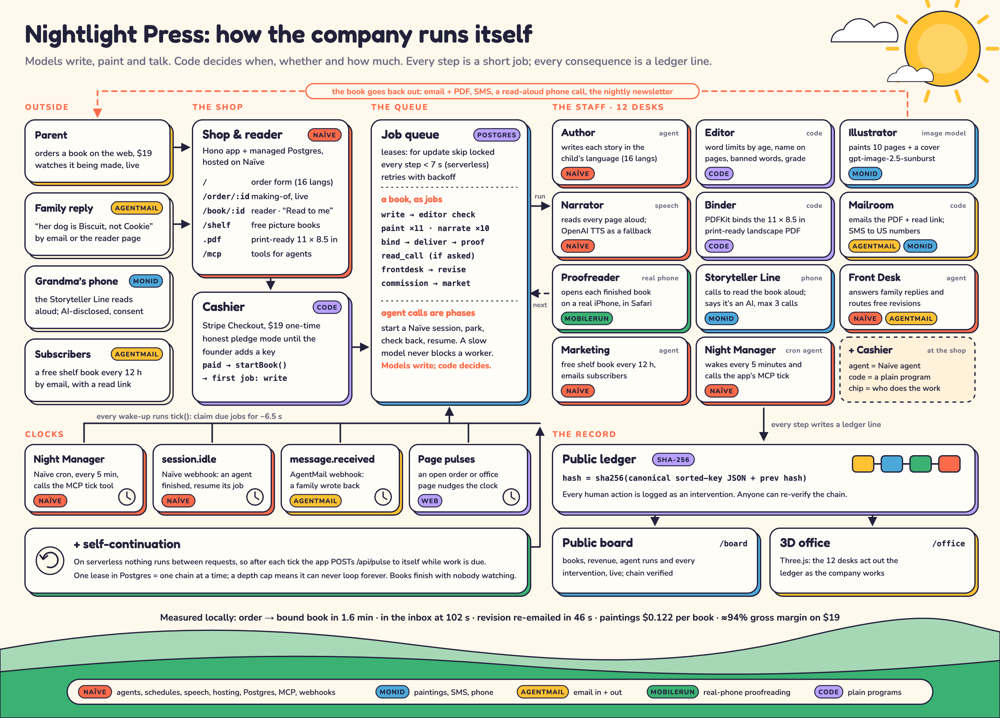
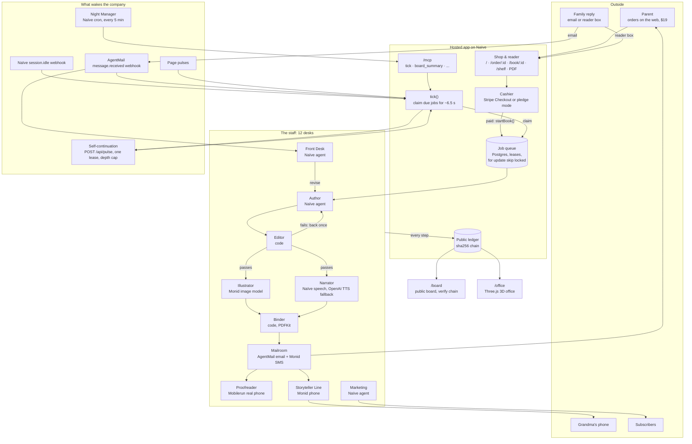

# Nightlight Press: architecture

Nightlight Press is a children's picture-book publisher with no employees. This document explains the engine that makes that work: one Postgres job queue, twelve desks, five ways to wake up, and a public hash-chained ledger.



## The four rules

1. **Models write, code decides.** Agents and models do the creative work: the story, the paintings, the voice, the reply to a family. Plain programs decide when something happens, whether it passes, who gets contacted and how much is spent.
2. **Every step is a short job.** Production is a chain of rows in one `jobs` table. Every handler finishes in under 7 seconds, so the whole company runs on serverless functions.
3. **Nobody is home between requests.** On serverless hosting nothing runs unless something calls in. So there are four clocks plus self-continuation, and any one of them is enough to keep a book moving.
4. **Every consequence is a ledger line.** Commissions, edits, stories, paintings, deliveries, calls, failures and human interventions are each appended to a hash-chained public ledger. The board and the 3D office are views of that ledger.

## The whole system



## The job queue (`app/src/jobs.js`)

Every step of the company is a row in `jobs`:

| Column | Meaning |
|---|---|
| `kind` | which handler runs it (`write`, `paint`, `narrate`, ...) |
| `order_id`, `book_id`, `page_id` | what it works on |
| `payload` | handler state, including agent-session phases |
| `status` | `queued` → `waiting` (parked or retrying) → `done` / `failed` |
| `next_run_at` | earliest time it may run again |
| `lease_until` | who holds it, for how long (40 s) |
| `polls`, `errors`, `error` | bookkeeping shown on the board |

The queue has four verbs:

- **`claim()`** picks the oldest due job that nobody holds, using `select ... for update skip locked`, and stamps a 40-second lease on it. Two workers can never get the same job, and if a worker dies its lease simply runs out.
- **`park(job, { ms, payload })`** says "not yet". The job goes back to `waiting` with a new `next_run_at` and any state saved in its payload. This is how long work is split into steps of under 7 seconds.
- **`done(job, result)`** finishes the job and stores the result.
- **`fail(job, err)`** retries with linear backoff (15 s, 30 s, 45 s). On the fourth error the job is marked `failed` and a `job_failed` line goes on the ledger. A handler can throw `Retry(msg, ms)` to ask for a specific delay without counting an error.

## Agent calls are resumable phases (`agentPhase` in `app/src/engine.js`)

A model call can take a minute, but a handler only gets a few seconds. So each agent call becomes a phase stored in the job's payload:

1. **Start.** Open a Naïve agent session with a budget, an `output_schema` and metadata (order, job, purpose). Record it in `agent_runs`, write an `agent_start` ledger line, save the session id as `payload.phase_N`, then park for 3 s.
2. **Check.** On each later run, ask Naïve whether the session is done. If it isn't, park for 2 s. A session that takes more than 5 minutes is dropped and started again.
3. **Resume.** When the session is done, store its cost and summary and hand the structured output to code. If it failed or returned no valid output, retry it, and give up after 3 failures.

Naïve's `session.idle` webhook means a finished session usually resumes its job at once, without waiting for the next poll. A slow model never ties up a worker, and a crash at any point loses nothing, because the state lives in Postgres.

## A book, job by job

| Job | Desk | What happens | Next |
|---|---|---|---|
| `write` | Author + Editor | The Author (Naïve agent) returns the story as JSON in the child's language. `checkStory()` (code) checks word limits for the age, the child's name on the pages, banned words and brands, and reading grade. If it fails, the draft goes back once with the exact problems. | 1 `paint` for the cover, plus 10 `paint` and 10 `narrate` |
| `paint` | Illustrator | Monid paints the page with `gpt-image-2.5-sunburst`, from a prompt that code builds out of the book's art style, the hero's look and the page's scene. | `maybeBind()` |
| `narrate` | Narrator | Naïve speech reads the page. If that fails, OpenAI TTS does it instead. | `maybeBind()` |
| `bind` | Binder | `maybeBind()` waits until every page has art and audio and the cover exists. Then PDFKit lays out the 11 × 8.5 in landscape PDF. | `deliver` (customer) or `market` (shelf book) |
| `deliver` | Mailroom | AgentMail emails the PDF and the reader link. Monid texts US numbers. | `proof`, and `read_call` if asked |
| `proof` | Proofreader | Mobilerun opens the finished book on a real phone and saves its screenshot as a proof. | — |
| `read_call` | Storyteller Line | Monid phones the number the family gave and reads the book aloud. The line says it is an AI, needs consent, and makes at most 3 calls per book. | — |
| `frontdesk` | Front Desk | A Naïve agent reads a family's message, from the AgentMail webhook or the reader box, and decides on a reply and an intent (`revise_text`, `revise_art`, `revise_both`, or just a reply). It escalates refunds and anything worrying to a person. | `revise` |
| `revise` | Author / Illustrator / Narrator | Only the pages that changed are redone. New text clears that page's audio, and new art clears its image. | `bind` → `deliver` with `revised: true` |
| `commission` | Marketing | A Naïve agent picks tonight's free shelf book, varying heroes, cultures, occasions and styles, and avoids the last 12 titles. | `write` ... `bind` → `market` |
| `market` | Marketing | Publishes the book to `/shelf`, emails subscribers, and posts to Instagram through Mobilerun only if `MOBILERUN_SOCIAL=1`. | — |

Measured on a local run: order to bound book in 1.6 minutes, in the inbox at 102 seconds, revision request to re-emailed book in 46 seconds.

## What wakes the company

`tick({ budgetMs: 6500 })` is the only thing that does work. It records which clock called it, checks whether the shelf book is due, then claims and runs due jobs until its 6.5-second budget is used up. Five different things call it:

| Clock | Path in | Why it exists |
|---|---|---|
| **Night Manager** | A Naïve scheduled agent (`*/5 * * * *`, America/Los_Angeles) calls the `tick` and `board_summary` tools on the app's MCP endpoint | A heartbeat that does not depend on any traffic |
| **`session.idle`** | `POST /api/webhooks/naive` (HMAC-signed) | Resumes a parked agent phase the moment its session finishes |
| **`message.received`** | `POST /api/webhooks/agentmail` (Svix-signed) | A family's reply becomes a `frontdesk` job and a tick straight away |
| **Page pulses** | Open making-of, reader, board and office pages call `POST /api/pulse` | Things move quickly while someone is watching |
| **Self-continuation** | `chainPulse()` → `POST /api/pulse` | Finishes a book with nobody watching and no cron due |

**Self-continuation** is the piece that makes serverless work. After a tick, if any job is due within 10 seconds, the app POSTs to its own `/api/pulse` with an `x-chain-depth` header and doesn't wait for the answer. A lease row in `kv` (`chain`, 15 s) means only one chain runs at a time. The depth is capped (`CHAIN_MAX`, 400 by default), so a bug can never turn into an infinite loop. It only runs on an `https://` base URL and can be switched off with `SELF_PULSE=0`.

**The nightly shelf book** has the same protection against duplicates. The commission claim is a single atomic upsert on `kv.last_commission` that succeeds only if the last commission is older than `SHELF_EVERY_HOURS` (12). Two ticks at the same moment can never commission the same book twice.

## The public ledger (`app/src/db.js`)

```
hash = sha256( canonical_json({ kind, actor, detail, order_id, prev_hash }) )
```

- `canonical_json` sorts keys at every level, so the same entry always hashes the same way.
- Entries are appended under a Postgres advisory lock, so the chain never forks.
- `actor` says who did it: `code`, `code:editor`, `agent:author`, `agent:marketer`, or `human:<who>`.
- `GET /api/ledger.json` publishes the ledger. `GET /api/verify` re-hashes every row and reports the first row where the chain breaks, if there is one.
- Every human action, such as retrying failed jobs or commissioning a book by hand, is written both to `interventions` and to the ledger as `intervention`. The board lists these, so the company's autonomy can be checked by anyone.

## Views of the ledger

- **`/board`** (`GET /api/board`): books made, shelf, revenue (with pledges kept separate), median time to book, image and call costs, agent runs and their cost, live and failed jobs, interventions, and the recent ledger with its hashes.
- **`/office`** (`GET /api/office?since=`): a Three.js office (`app/public/js/office.js`) with the 12 desks. Each ledger line and job is mapped to the desk that did it (`write`/`revise` → Author, `paint` → Illustrator, `deliver` → Mailroom, and so on) and acted out on the floor. **Replay** plays back the last book.

## The MCP endpoint (`app/src/mcp.js`)

`POST /mcp` speaks JSON-RPC MCP behind a bearer token. Its tools are `tick`, `board_summary`, `commission_shelf_book`, `recent_books` and `note`. The Night Manager is allowed `tick` and `board_summary` only, and every other agent has no app access at all.

## Deployment

- **`naive.config.ts`** is the company blueprint. It declares the public identity, a vault with the sponsor credentials (AgentMail, Monid and Mobilerun as bearer credentials for their MCP servers), the four agents with their models, budgets and deny-by-default tool permissions, the Night Manager's schedule, Marketing's evening schedule, and the `nightlight-press` fullstack app with its env, migrations and MCP path. There are **no board tasks**: production lives entirely in the app's queue.
- **`deploy.sh`** builds the app (`app/build.mjs` uses esbuild to bundle a single serverless function with a 30 s max duration and rewrites for pages, API and `/mcp`), then runs `naive up` and retries while Naïve is busy.
- **Migrations** (`app/migrations/001_init.sql`) are applied on boot and tracked in `_migrations`.
- **Local**: `app/dev.sh` runs the same code on `http://localhost:3100`.

## Safety boundaries in code

- The Editor's checks, the US-only SMS rule, the 3-call limit, the consent requirement and the AI disclosure are all in code, not in prompts.
- Agents get budgets and deny-by-default tools. Creative agents have no app access.
- Public social posting is off unless `MOBILERUN_SOCIAL=1`.
- Without `STRIPE_SECRET_KEY`, the Cashier runs in pledge mode, and pledges are never reported as revenue.
- Webhooks are signature-checked. Admin routes need a token, and every use of them becomes a public intervention.
